## From neural mechanisms to translational markers

::: {.lead}
My research focus is on [neuronal plasticity]{.highlight}. Using different approaches:
:::

::: {.research-map}
::: {.fragment .map-item}
**01 · Ephys**

How does sensory experience shape visual circuits?
:::
::: {.fragment .map-item}
**02 · Functional Imaging**

How activation in different brain areas is affected by visual experience?
:::
::: {.fragment .map-item}
**03 · Behavior**

Is experience influencing brain output?
:::
:::

## How I got here and where I am going

::: {.columns}
::: {.column width="70%"}

::: {.lead}
My work on [visual cortical plasticity]{.highlight} has evolved from understanding its molecular regulation to decoding visual information for translational applications.
:::

:::
::: {.column width="30%"}

{.leftimg width="80%"}

:::
:::

::: {.research-map .journey-map}
::: {.fragment .map-item}
**01 · Epigenetic control**

I first investigated how epigenetic (such as `MiR-132/212`) factors regulate ocular-dominance plasticity and the development of depth perception.

:::
::: {.fragment .map-item}
**02 · Peripheral modulation**

I then examined how peripheral factors influence (like `gut microbiome`) visual cortical plasticity and shape the brain’s response to sensory experience.

:::
::: {.fragment .map-item}
**03 · Neural decoding & prosthetics**

I am now studying V1 neural codes to reconstruct what a mouse sees over time, with potential applications in visual prosthetics of the `optic nerve`.

:::
:::

## Selected publications - visual cortical plasticity

::: {.publication-list .publication-sequence .visual-publications}
::: {.fragment .publication-item}

:::
::: {.publication-item}

:::
::: {.publication-item}

:::
::: {.publication-item}

:::
::: {.publication-item}

:::
::: {.publication-item}

:::
::: {.publication-item}

:::
::: {.publication-item}

:::
:::

## Functional imaging in neurodevelopmental disorders

::: {.lead}
I use functional imaging to identify [physiological biomarkers]{.highlight} in neurodevelopmental disorders: quantitative signals that can <u>describe brain function</u> beyond clinical observation alone.
:::

::: {.research-map}
::: {.fragment .map-item}
**01 · The goal**

Identify robust <u>functional biomarkers</u> that distinguish altered neural processing and can be followed <u>across development or treatment</u>.
:::
::: {.fragment .map-item}
**02 · Disease models**

I focus on <u>CDKL5</u> Deficiency Disorder (CDD) and <u>Creatine</u> Transporter Deficiency (CTD), two conditions with distinct developmental and neurological phenotypes.
:::
::: {.fragment .map-item}
**03 · Multimodal readouts**

Intrinsic optical signal imaging, visual evoked potentials and EEG provide <u>complementary measures</u> of cortical function.
:::
:::

::: {.fragment .callout}
The aim is not a single measure, but an interpretable [biosignature]{.core}: a profile that links circuit function to the clinical phenotype.
:::

## Neurodevelopmental biomarkers: selected outputs

::: {.columns .biomarker-columns}
::: {.column width="37%"}

:::
::: {.column width="63%"}
::: {.biomarker-gallery}
::: {.fragment .biomarker-figure}

:::
::: {.fragment .biomarker-figure}

:::
::: {.fragment .biomarker-figure}

:::
::: {.fragment .pca-overlay}

:::
:::
:::
:::

## Selected publications - neurodevelopmental disorders

::: {.publication-list .publication-sequence}
::: {.fragment .publication-item}

:::
::: {.publication-item}

:::
::: {.publication-item}

:::
::: {.publication-item}

:::
::: {.publication-item}

:::
::: {.publication-item}

:::
::: {.publication-item}

:::
:::

## fNIRS in humans

::: {.lead}
Functional near-infrared spectroscopy (<u>fNIRS</u>) measures cortical haemodynamic responses in [human participants]{.highlight} during engaging, age-appropriate tasks.
:::

::: {.research-map .fnirs-map}
::: {.fragment .map-item}
**01 · Non-invasive measurement**

Portable, non-invasive fNIRS allows participants to watch audiovisual stimuli or interact with an experimenter while cortical responses are recorded.

:::
::: {.fragment .map-item}
**02 · Across development**

fNIRS can be used in children and adults to study <u>developmental trajectories and individual differences</u>.

:::
::: {.fragment .map-item}
**03 · Translational potential**

Human fNIRS can link circuit-level findings from preclinical models to functional measures relevant to clinical studies.

:::
:::

## Human fNIRS: from stimulus to functional marker

::: {.two-col .fnirs-comparison}
::: {.panel}
**Child-friendly paradigms**

Age-appropriate cartoons chosen with participants can sustain attention while retaining experimental control.
This approach can improve recording quality in children and clinical populations.

<video class="research-video" src="images/imgs/fnirs_peppa.mp4" data-autoplay autoplay loop muted playsinline preload="auto" aria-label="Child-friendly fNIRS stimulus"></video>

:::
::: {.panel}
**Physiological readouts**

- Changes in oxygenated and deoxygenated haemoglobin
- Response amplitude and timing
- Hemispheric asymmetry and functional connectivity
- Variation across participants

:::
:::

## fNIRS as a candidate human biomarker

::: {.two-col .fnirs-evidence .fnirs-biomarker}
::: {.panel}
**Visual responses and autistic traits**

In typically developing children, the amplitude of the visually evoked haemodynamic response is associated with Autism Spectrum Quotient (AQ) scores.

::: {.evidence-figure}
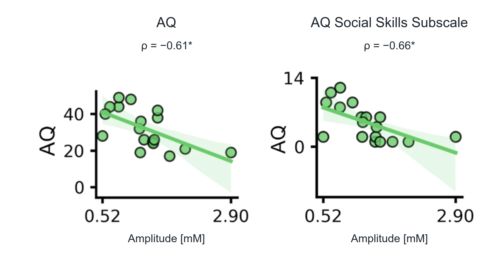
:::
::: {.evidence-source}
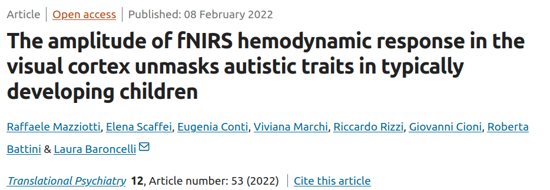
:::
:::
::: {.panel}
**Visual responses in autism**

In preschoolers with autism spectrum disorder (ASD), visually evoked cortical responses were reduced relative to controls.

::: {.evidence-figure}
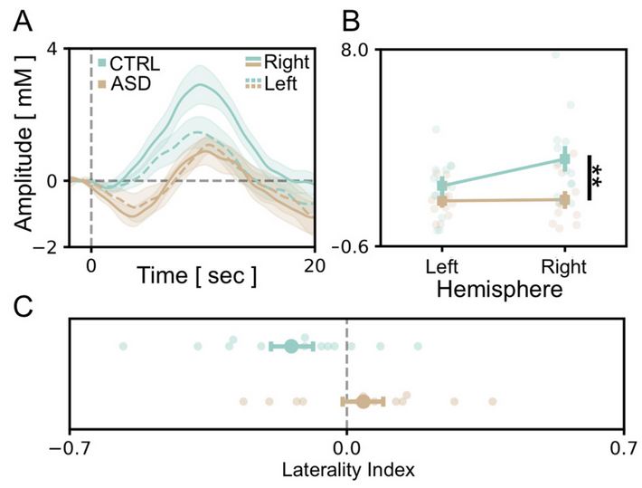
:::
::: {.evidence-source}
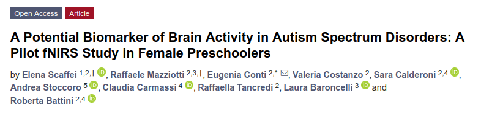
:::
:::
:::

## Translational fNIRS in creatine transporter deficiency

::: {.preliminary-badge}
Preliminary results
:::

::: {.two-col .fnirs-evidence .ctd-fnirs}
::: {.panel}
**Human fNIRS**

In participants with creatine transporter deficiency (CTD), visually evoked oxygenated haemoglobin (HbO) responses were larger than in controls.

::: {.evidence-figure}
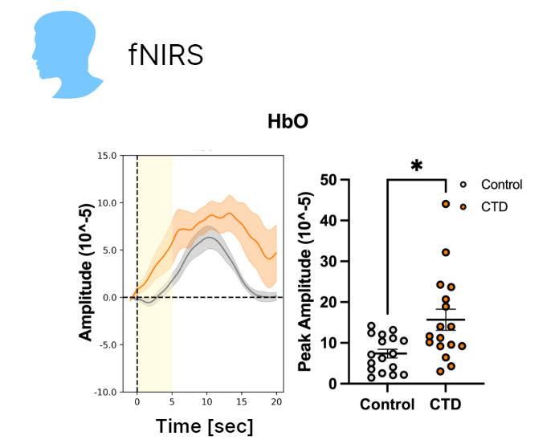
:::
:::
::: {.panel}
**Preclinical IOS**

Intrinsic optical signal (IOS) imaging in a mouse model also reveals altered visual cortical responses.

::: {.evidence-figure}
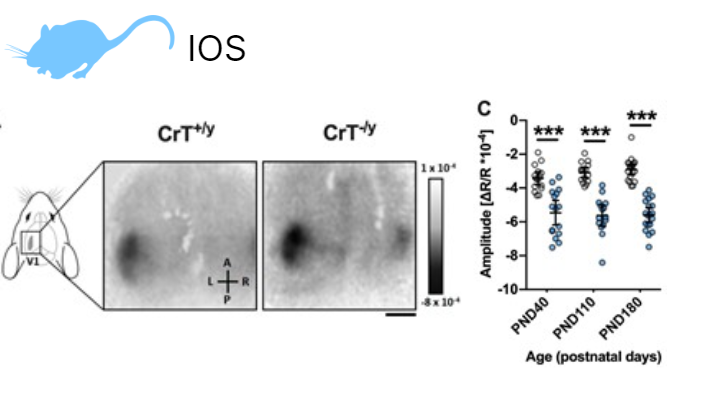
:::
::: {.evidence-source}
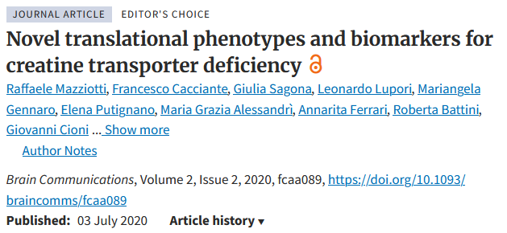
:::
:::
:::

## Pupillometry

::: {.two-col .pupillometry-showcase}
::: {.panel .meye-panel}
<h3>MEYE Interspecies pupillometry</h3>

Open-source pupil tracking across species, from camera recordings to quantitative pupil traces.

<video src="images/imgs/pupil_interspecie.mp4" data-autoplay autoplay loop muted playsinline preload="auto" aria-label="MEYE interspecies pupil tracking"></video>
<video src="images/imgs/frank_stabilized.mp4" data-autoplay autoplay loop muted playsinline preload="auto" aria-label="Stabilized eye recording"></video>

<a class="pupillometry-publication" href="https://doi.org/10.1523/ENEURO.0122-21.2021" target="_blank" rel="noopener" aria-label="Open the MEYE publication">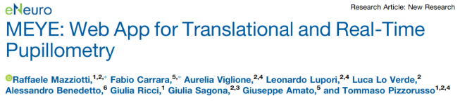</a>
:::
::: {.panel .meyelens-panel}
<h3>MEYELens Open pupillometry and gaze tracking</h3>

<figure>
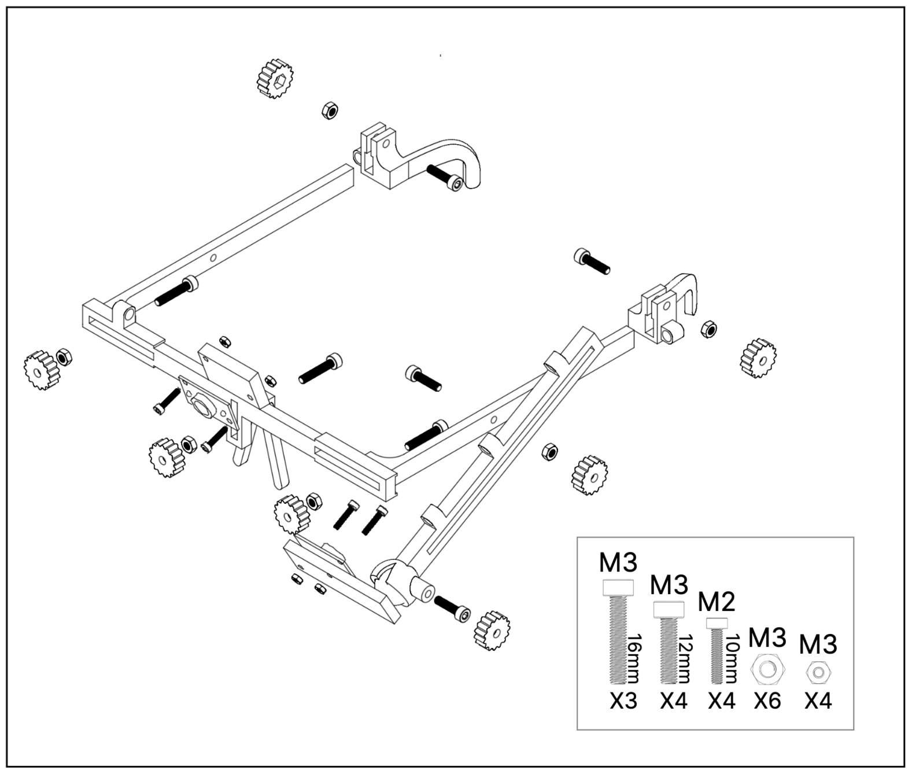
<figcaption>Open hardware</figcaption>
</figure>
<figure>
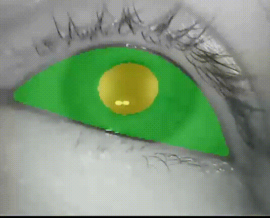
<figcaption>Pupil tracking</figcaption>
</figure>

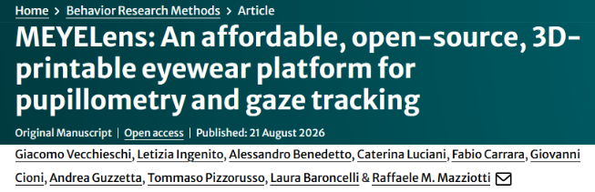

<a class="meyelens-site-link" href="https://meyelens.com/" target="_blank" rel="noopener">Open meyelens.com</a>
:::
:::

## Pupillometry applications

::: {.two-col .pupil-applications}
::: {.panel .application-panel}
<h3>CDKL5 deficiency</h3>

CDKL5 mutant mice show altered locomotor activity and pupil size, suggesting changes in arousal regulation.

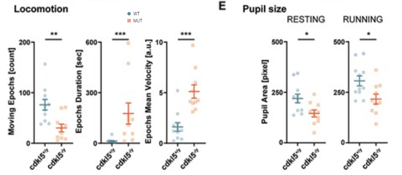

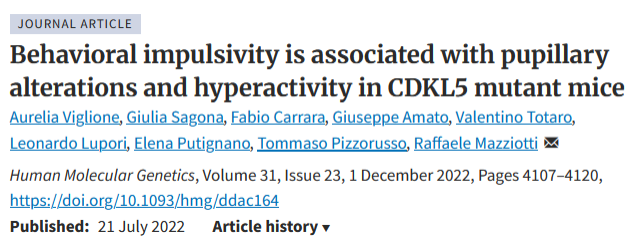

:::
::: {.panel .application-panel}
<h3>Emotional contagion</h3>

Pupil dilation scales with stimulus intensity in demonstrators and observers, providing a quantitative readout of vicarious responses.

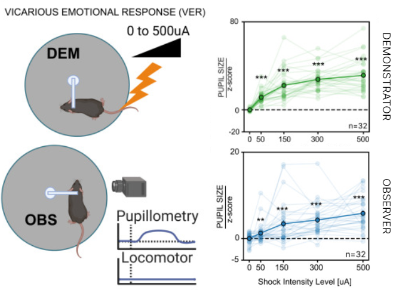

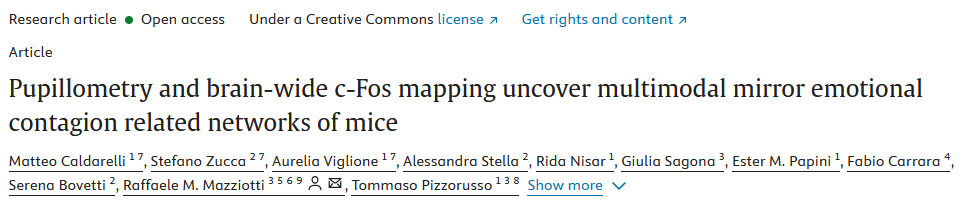

:::
:::

## Widefield imaging and pupillometry

::: {.preliminary-badge}
Preliminary results
:::

<figure><a href="images/widefield/1_atlas_alignment.png" target="_blank" aria-label="Open atlas alignment at full size">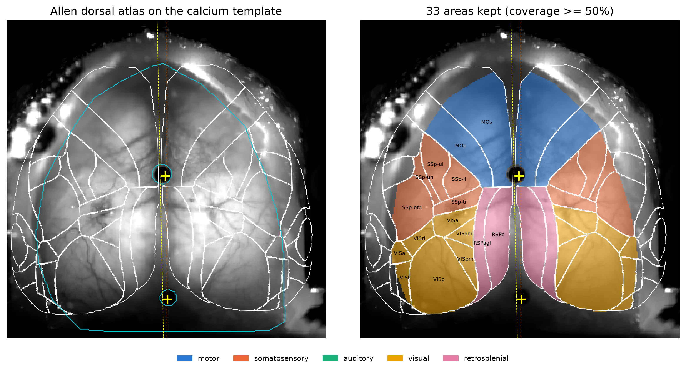</a><figcaption>Atlas alignment</figcaption></figure>
<figure><video src="images/widefield/dff_areas_web.mp4" poster="images/widefield/dff_poster.png" data-autoplay autoplay loop muted playsinline preload="auto" aria-label="Regional calcium activity across the cortical atlas"></video><figcaption>Regional calcium activity</figcaption></figure>
<figure><a href="images/widefield/4_area_dff_behavior.png" target="_blank" aria-label="Open activity and behaviour plot at full size">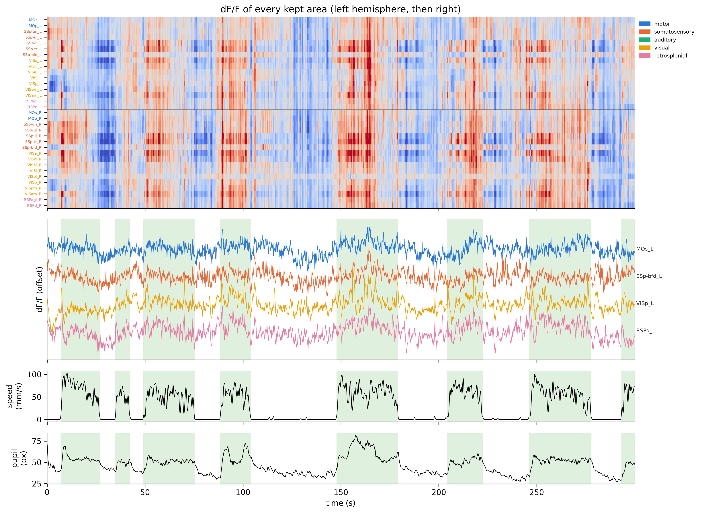</a><figcaption>Activity and behaviour</figcaption></figure>
<figure><video src="images/widefield/eye_masks_web.mp4" poster="images/widefield/eye_poster.png" data-autoplay autoplay loop muted playsinline preload="auto" aria-label="Eye and pupil segmentation masks"></video><figcaption>Eye and pupil masks</figcaption></figure>

## Brain Endoscopy

::: {.preliminary-badge}
Preliminary results
:::

<figure class="miniscope-setup">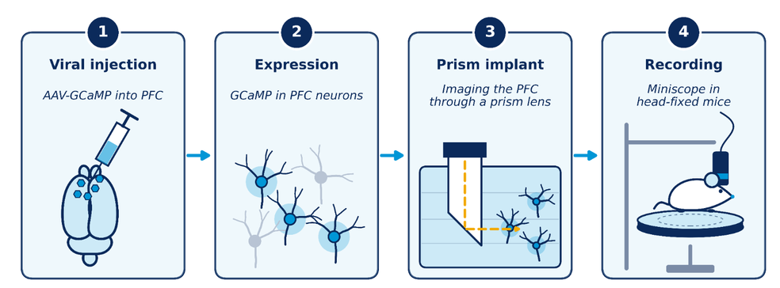<figcaption>Recording setup</figcaption></figure>
<figure class="miniscope-video"><video src="images/miniscope/miniscope_web.mp4" poster="images/miniscope/miniscope_poster.png" data-autoplay autoplay loop muted playsinline preload="auto" aria-label="Miniscope calcium activity recording"></video><figcaption>Calcium activity</figcaption></figure>
<figure class="miniscope-traces"><a href="images/miniscope/recordings.png" target="_blank" aria-label="Open extracted calcium traces at full size">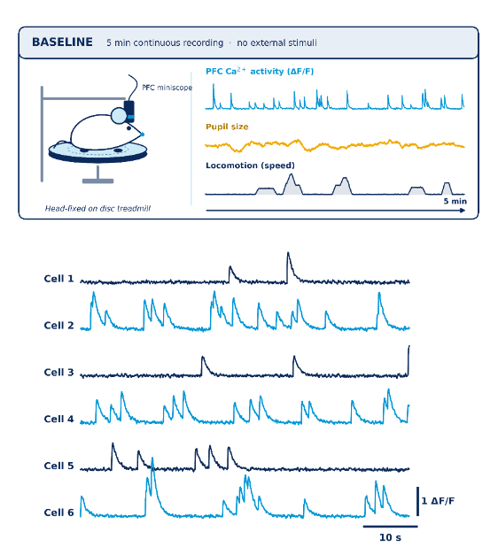</a><figcaption>Extracted calcium traces</figcaption></figure>

