## From neural mechanisms to translational markers

::: {.lead}
My research focus is on [neuronal plasticity]{.highlight}. Using different approaches:
:::

::: {.research-map}
::: {.fragment .map-item}
**01 · Ephys**

How does sensory experience shape visual circuits?
:::
::: {.fragment .map-item}
**02 · Functional Imaging**

How activation in different brain areas is affected by visual experience?
:::
::: {.fragment .map-item}
**03 · Behavior**

Is experience influencing brain output?
:::
:::

## How I got here and where I am going

::: {.columns}
::: {.column width="70%"}

::: {.lead}
My work on [visual cortical plasticity]{.highlight} has evolved from understanding its molecular regulation to decoding visual information for translational applications.
:::

:::
::: {.column width="30%"}

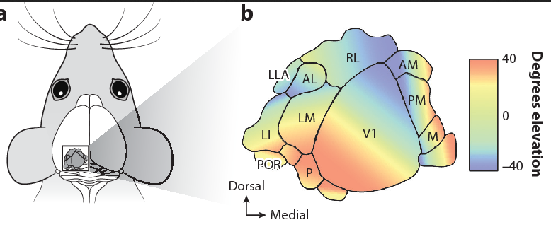{.leftimg width="80%"}

:::
:::

::: {.research-map .journey-map}
::: {.fragment .map-item}
**01 · Epigenetic control**

I first investigated how epigenetic (such as `MiR-132/212`) factors regulate ocular-dominance plasticity and the development of depth perception.

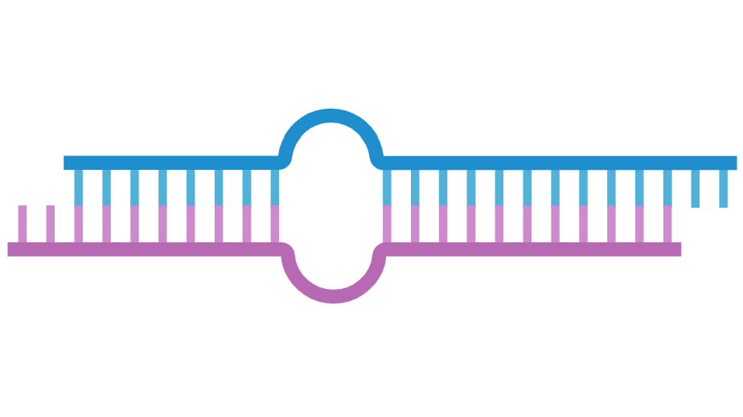

:::
::: {.fragment .map-item}
**02 · Peripheral modulation**

I then examined how peripheral factors influence (like `gut microbiome`) visual cortical plasticity and shape the brain’s response to sensory experience.

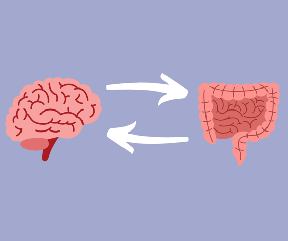

:::
::: {.fragment .map-item}
**03 · Neural decoding & prosthetics**

I am now studying V1 neural codes to reconstruct what a mouse sees over time, with potential applications in visual prosthetics of the `optic nerve`.

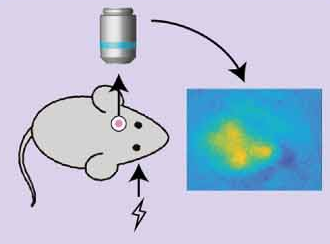
:::
:::

::: {.fragment .callout}
The common thread is understanding how experience is translated into a stable — and potentially decodable — cortical representation.
:::

## Selected publications — visual cortical plasticity

::: {.publication-list .visual-publications}
::: {.fragment .publication-item}

:::
::: {.fragment .publication-item}

:::
::: {.fragment .publication-item}

:::
::: {.fragment .publication-item}

:::
::: {.fragment .publication-item}

:::
::: {.fragment .publication-item}
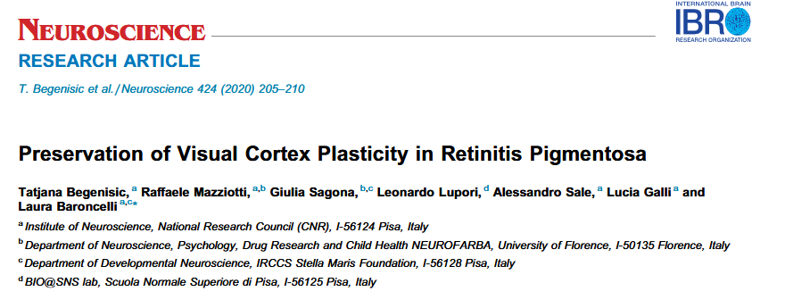
:::
::: {.fragment .publication-item}
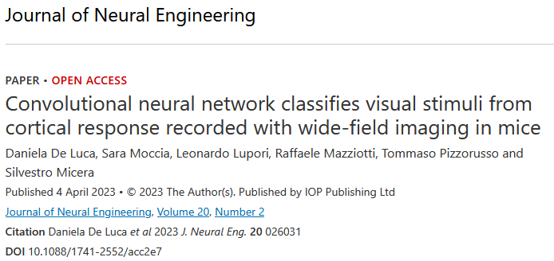
:::
::: {.fragment .publication-item}
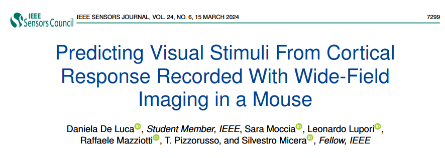
:::
:::

## Functional imaging in neurodevelopmental disorders

::: {.lead}
I use functional imaging to identify [physiological biomarkers]{.highlight} in neurodevelopmental disorders: quantitative signals that can <u>describe brain function</u> beyond clinical observation alone.
:::

::: {.research-map}
::: {.fragment .map-item}
**01 · The goal**

Identify robust <u>functional biomarkers</u> that distinguish altered neural processing and can be followed <u>across development or treatment</u>.
:::
::: {.fragment .map-item}
**02 · Disease models**

I focus on <u>CDKL5</u> Deficiency Disorder (CDD) and <u>Creatine</u> Transporter Deficiency (CTD), two conditions with distinct developmental and neurological phenotypes.
:::
::: {.fragment .map-item}
**03 · Multimodal readouts**

Intrinsic optical signal imaging, visual evoked potentials and EEG provide <u>complementary measures</u> of cortical function.
:::
:::

::: {.fragment .callout}
The aim is not a single measure, but an interpretable [biosignature]{.core}: a profile that links circuit function to the clinical phenotype.
:::

## Neurodevelopmental biomarkers: selected outputs

::: {.columns .biomarker-columns}
::: {.column width="37%"}
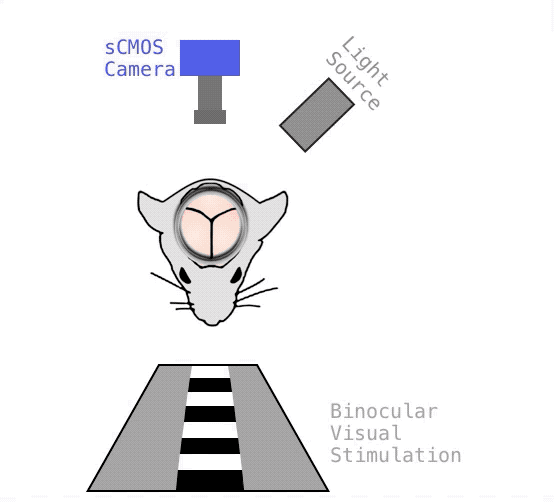
:::
::: {.column width="63%"}
::: {.biomarker-gallery}
::: {.fragment .biomarker-figure}

:::
::: {.fragment .biomarker-figure}

:::
::: {.fragment .biomarker-figure}

:::
::: {.fragment .pca-overlay}
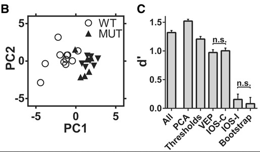
:::
:::
:::
:::

## Selected publications — neurodevelopmental disorders

::: {.publication-list}
::: {.fragment .publication-item}

:::
::: {.fragment .publication-item}

:::
::: {.fragment .publication-item}

:::
::: {.fragment .publication-item}

:::
::: {.fragment .publication-item}

:::
::: {.fragment .publication-item}

:::
::: {.fragment .publication-item}

:::
:::

## fNIRS in humans

::: {.lead}
Functional near-infrared spectroscopy (<u>fNIRS</u>) makes it possible to measure cortical haemodynamics in [human participants]{.highlight} during engaging and developmentally appropriate tasks.
:::

::: {.research-map .fnirs-map}
::: {.fragment .map-item}
**01 · Non-invasive measurement**

Portable, non-invasive fNIRS can be used while participants watch audiovisual material or engage with an experimenter.

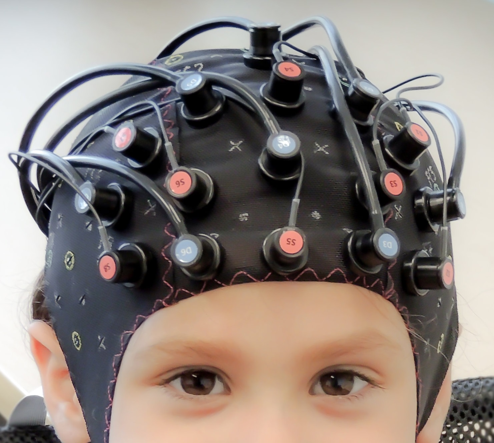

:::
::: {.fragment .map-item}
**02 · Across development**

The method is well suited to children and adults, for studies of <u>developmental trajectories and individual variability</u>.

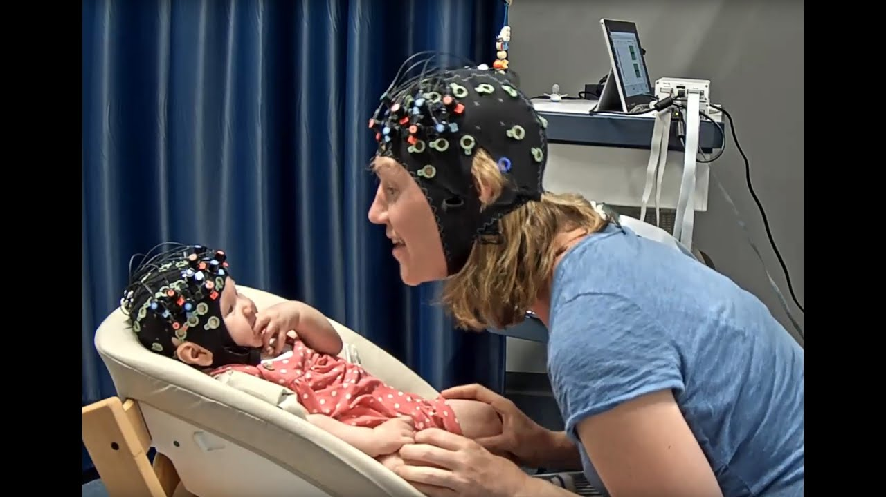

:::
::: {.fragment .map-item}
**03 · Translational potential**

Human fNIRS can connect circuit-level findings from preclinical models to clinically relevant functional measures.

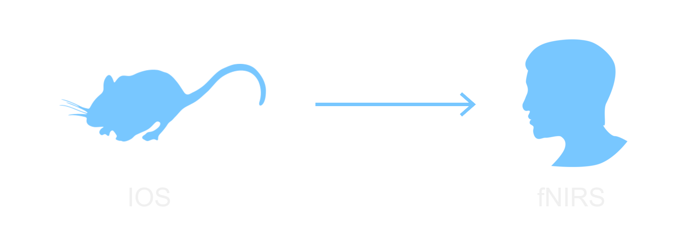

:::
:::

## Human fNIRS: from stimulus to functional marker

::: {.two-col .fnirs-comparison}
::: {.panel}
**Child-friendly paradigms**

Engaging audiovisual stimuli based on cartoons selected by the participants that help maintain attention while preserving experimental control.
This makes it possible to acquire higher-quality recordings in children and clinical populations.

<video class="research-video" src="images/imgs/fnirs_peppa.mp4" autoplay loop muted playsinline preload="auto" aria-label="Child-friendly fNIRS stimulus"></video>

:::
::: {.panel}
**Physiological readouts**

- Oxy- and deoxyhaemoglobin responses
- Response amplitude and latency
- Lateralisation and functional connectivity
- Between-participant variability

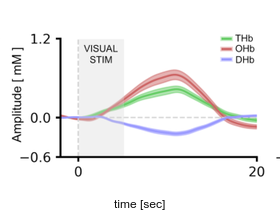

:::
:::

## fNIRS as a candidate human biomarker

::: {.flow}
::: {.flow-step}
**Engaging task**

Present a developmentally appropriate audiovisual or social stimulus.
:::
::: {.flow-arrow}
→
:::
::: {.flow-step}
**Haemodynamic response**

Measure the cortical response with fNIRS over time.
:::
::: {.flow-arrow}
→
:::
::: {.flow-step}
**Functional profile**

Relate response features to age, social abilities or clinical phenotype.
:::
:::

::: {.fragment .callout}
The objective is to identify reproducible human markers that can complement behavioural assessment and other physiological measures.
:::
